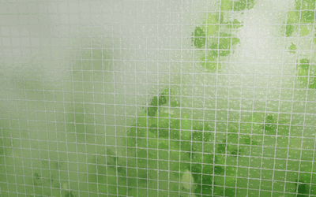
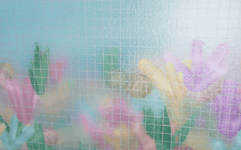
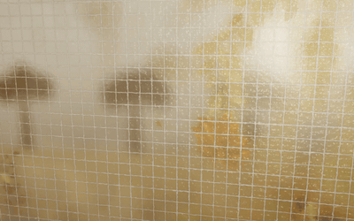
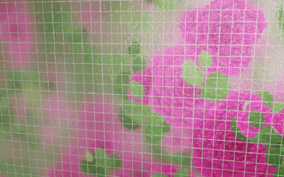

# Wired Glass

A Three.js scene of hammered wired glass: a pebbled glass pane with a square wire
mesh inside it, a living scene behind it, and a light that blooms through the glass.
The pane is a rigid 3D slab that leans toward your finger or cursor, so touching near
a corner lifts that corner toward you. Four scenes sit behind the same glass: a
garden, a coral reef, autumn oaks and climbing roses.

## Scenes

<table>
  <tr>
    <td><br><b>Garden</b></td>
    <td><br><b>Reef</b></td>
  </tr>
  <tr>
    <td><br><b>Oak</b></td>
    <td><br><b>Roses</b></td>
  </tr>
</table>

| Scene | Link | What's behind the glass |
| --- | --- | --- |
| Garden | `#garden` | Backlit green foliage, open to a bright sky in the upper left. |
| Reef | `#reef` | Branching and brain coral with seagrass on the sea floor. Sun shafts from the surface, caustic light ripples and rising bubbles. |
| Oak | `#oak` | Autumn oak leaves on twigs, with leaves drifting down. A row of oak trees on the horizon shows as silhouettes in warm haze. |
| Roses | `#roses` | Magenta roses with layered, ruffled petals among toothed rose leaves and red-brown canes. Green foliage with bright gaps behind, and falling petals. |

Switch scenes with the buttons at the bottom of the page or the "Scene" picker in the
settings panel. Adding `#reef`, `#oak` or `#roses` to the address opens that scene
directly. Each scene also tints the glass and the wire slightly.

## Run it

The whole demo is one file, `index.html`, with no build step. It loads
[three.js](https://threejs.org) 0.170.0 and [lil-gui](https://lil-gui.georgealways.com)
0.19.2 from the jsDelivr CDN, so it needs an internet connection.

```bash
# any static server works, for example:
npx serve .
# or
python3 -m http.server 8000
```

Then open the printed address. Opening `index.html` directly from disk also works in
most browsers.

**GitHub Pages:** in the repository settings, go to Pages and choose "Deploy from a
branch", with `main` and `/ (root)`. The demo is then served at
`https://<user>.github.io/<repo>/`.

**Offline:** download the two library files and point the `<script type="importmap">`
block at the top of `index.html` to your local copies.

## Controls

Use the buttons at the bottom to change scene. Hover, or touch and drag, near any
part of the glass to lean that part toward you;
pressing brings it closer still. The light follows the finger, and drifts on its own
when idle. The lil-gui panel exposes the pane's tilt, lift, spring damping, minimum size, an "always cover screen" switch and thickness, plus dimple size/depth, near/far refraction, blur, haze,
glints, wire cell size/width/wobble, wind and parallax.

Requires WebGL 2. Rendering is capped at 1.75× device pixel ratio to keep phones
smooth.

## Code layout

`index.html` is organised top to bottom as:

1. `params`: starting values for everything the settings panel controls.
2. `THEMES`: each scene's colours, haze, glass tint and backdrop depth.
3. **Scene pass:** the backdrop shader (sky, light, sun shafts, caustics, distant
   oaks), the instanced shapes, and the `SCENES` builders that lay out each scene.
4. **Glass pass:** the full-screen glass shader (dimples, refraction, depth blur,
   haze, glints, wire mesh), rendered into a texture.
5. **Pane pass:** the thin glass slab, `coverSize()`, the scene switcher, pointer
   springs and the frame loop.

## How the effect is built

The look comes from one idea: **the further something is behind textured glass,
the more the glass scrambles it.** Leaves pressed against the pane stay crisp;
whatever is a metre back becomes soft, milky colour.

### Pass 1 — the scene (render target)

* A full-screen backdrop shader: a sky or water gradient, far-away blurred mass from
  fBm noise, and the light source (hot core + wide bloom). Each scene adds its own
  backdrop. The reef gets sun shafts and caustics, and the oaks get a horizon of
  trees, each crown built from overlapping clumps with a ragged edge.
* Thousands of shapes drawn as one `InstancedBufferGeometry`. Each instance carries
  position, **distance from the glass**, rotation, scale, a seed, a shape, a colour
  and how it moves (sways, rises or falls). The vertex shader adds flutter, branch
  sway, drifting and pointer parallax (scaled by depth). The fragment shader cuts the shape:
  * a leaf, a lobed oak leaf or a toothed rose leaf;
  * a coral finger (a capsule with polyps), or brain coral;
  * a rose, built from rings of ruffled petals, each shadowed by the ring inside it;
  * a blossom or a bubble.

  Things near the light are brightened so they look backlit.
* Scenes are laid out from a seeded random generator, so each one looks the same
  on every load.
* Output: `RGB = colour`, `A = depth` (0 on the glass, 1 far away), into a
  half-float, MSAA, **mipmapped** render target.

### Pass 2 — the glass (full-screen shader)

1. **Surface normal.** Hammered glass is modelled as a height field of smooth
   Voronoi "dimples" (`log(Σ exp(-k·d²))`, which rounds the creases between
   cells), a second finer octave, and a slow value-noise undulation. The normal
   comes from finite differences.
2. **Depth-scaled refraction.** The refraction offset is
   `normal.xy * mix(refractNear, refractFar, depth)`, so near leaves barely wobble
   and far content is scrambled.
3. **Depth-scaled blur.** A 16-tap golden-angle disc, with radius growing with
   depth, sampled at a matching mip level so a big radius stays cheap. Each pixel
   gets a random rotation, which gives the fine frosted grain.
4. **Milky scatter.** A very low mip of the scene (light spread through the pane)
   is mixed in, more strongly for distant content.
5. **Glints.** Bump slopes facing the light flare up (`pow(dot(n, L), 90)` plus a
   rim term), limited to the area around the light.
6. **Wire mesh.** An anti-aliased square grid in pixel space, offset slightly by
   the surface normal (the wire sits inside the pane, so the front surface bends
   it a little). It is shaded as a round wire that picks up surrounding brightness,
   with a faint contact shadow.
7. ACES tone mapping, a light vignette and dither.

The result is rendered into a second render target (`glassRT`) at screen
resolution, with mipmaps and anisotropic filtering.

### Pass 3 — the pane (leans toward your finger)

The glass texture sits on the front face of a thin `BoxGeometry`. A perspective
camera looks at the box, and its edges are shaded green like the edge of wired glass.
At rest the pane faces you square-on and is **bigger than the screen**, so its
edges are always off-screen. On every resize, `coverSize()` raycasts the four screen
corners against the pane at full tilt toward each corner and edge, and picks the
smallest size that still covers the screen. That is about 1.25× on a phone in portrait and
about 1.55× on a 16:10 desktop. The "min size" setting (default 1.2×) is a floor. The garden
and glass textures are rendered at the pane's size, capped at 4096 px, so the glass
stays 1:1 with screen pixels.

The pane is rigid: only its **rotation and position** change, so it never bends.

* The finger or cursor position, from -1 to 1 across the pane, sets the lean:
  `rotation.x = ny * maxTilt` and `rotation.y = -nx * maxTilt`. That brings the point
  under the finger toward the camera, so touching near a corner lifts that corner
  while the opposite one falls back.
* While pressed (or, more gently, while hovering), the pane also moves toward the
  camera by `lift` and drifts slightly toward the finger.
* Damped springs (damping ratio about 0.6) drive all of this, so the pane leans in,
  overshoots a touch and settles. When the finger leaves, it springs back and goes
  on breathing gently.
* The view direction in the pane's own frame shifts the garden parallax, so leaning
  the pane reads as looking through a window at an angle. A broad reflection on the
  glass slides with the lean.
* Each frame, the pointer is raycast onto the moved pane so the light stays under
  the finger.

## Credits

Inspired by a Three.js wired-glass demo shared by neilson (@neilsonks on X). This is
an independent reimplementation; all code and shaders here were written from scratch.
